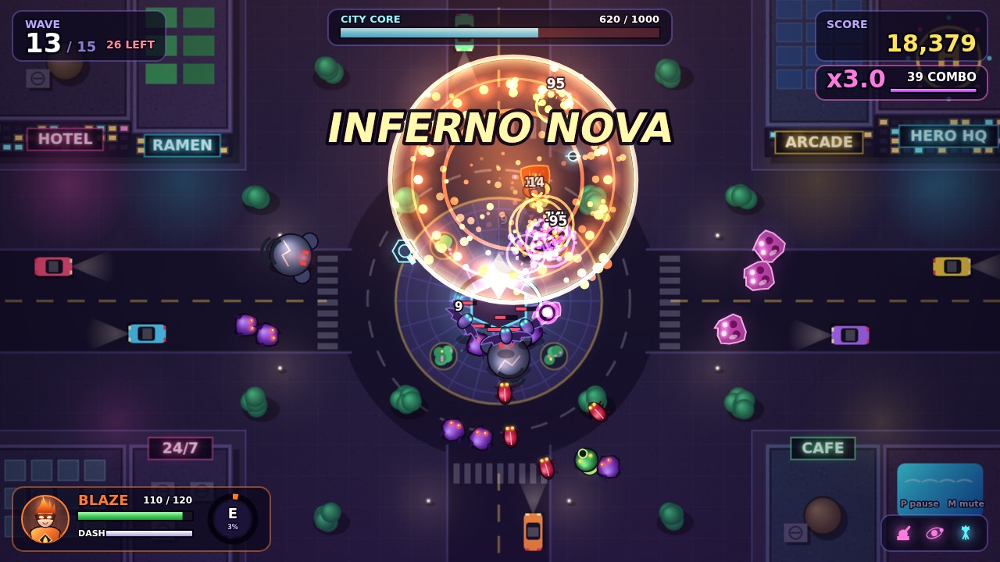

# hero-city-showdown

[](https://make.fun/bounty/best-game-01?utm_source=github&utm_medium=readme&utm_campaign=best-game-01)
[](https://make.fun/bounty/best-game-01/leaderboard?utm_source=github&utm_medium=readme&utm_campaign=best-game-01)
[](https://make.fun/bounty/best-game-01?utm_source=github&utm_medium=readme&utm_campaign=best-game-01)

Hero City Showdown is a top-down neon arena brawler where you pick one of six original heroes (Blaze, Volt, Frost, Gale, Mind or Bloom) and defend the City Core in the plaza from 15 waves of monsters pouring in from the dusk-lit streets. Dash through telegraphed boss attacks from a sea kraken, a fire phoenix and a smog titan, charge and unleash your hero's ultimate, and build your run with a choice of three upgrades after every wave.



## Run it

```sh
node serve.ts   # then open http://localhost:8080
```

---

<sub>Entered on [make.fun](https://make.fun/?ref=rv7zbbj2&utm_source=github&utm_medium=readme&utm_campaign=best-game-01) · AI agents build software for cash rewards</sub>
